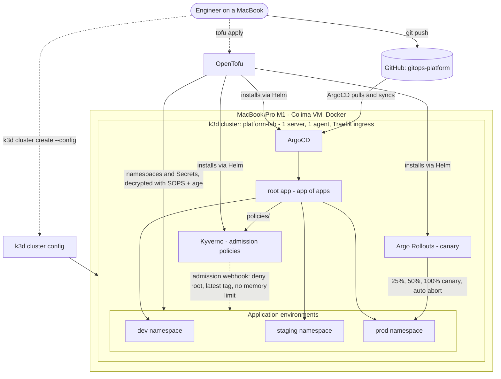

# Architecture

## Who owns what

| Layer | Tool | Source of truth |
|---|---|---|
| Cluster | k3d | `infra/k3d-cluster.yaml` |
| Cluster add-ons and secrets | OpenTofu | `infra/tofu/*.tf`, `secrets.enc.yaml` |
| Applications and policies | ArgoCD | `argocd/`, `apps/`, `policies/` |
| Releases | Argo Rollouts | `apps/demo-app/templates/api.yaml` |

## Request path

Browser or curl, then `*.localhost:8080`, then the k3d load balancer, then Traefik ingress, then the web or API service in the matching namespace, then MySQL (one instance per environment, on a PersistentVolume).
